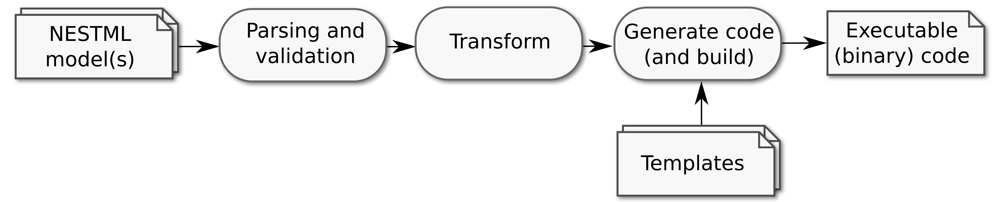

Extending NESTML
################

The NESTML toolchain is lightweight, modular and extensible.

Internal workflow
-----------------

When NESTML is invoked, several steps are executed in sequence. First, the model(s) are parsed and validated. Then, depending on which target platform has been selected, transformations may occur, such as variable name rewriting in case of conflict with a keyword in the target language). The transformed models are then passed to the code generator, which combines them with a set of templates. Finally, an optional build stage compiles and builds the code, for example to yield a dynamically loadable library (``.so`` or ``.dll`` file).

A more detailed description of the internal architecture of NESTML can be found in the following places:

* Tammo Ippen, "NESTML - Creating a Neuron Modeling Language and Generating Efficient Code for the NEST Simulator with MontiCore". Master's thesis, RWTH Aachen University (2013) :download:`PDF <extending/Tammo_Ippen_Master_Thesis.pdf>`
* Konstantin Perun, "Reengineering of NestML with Python". Master's thesis, RWTH Aachen University (2018) :download:`PDF <extending/Konstantin_Perun_Master_thesis.pdf>`
* Dimitri Plotnikov, "NESTML - die Domänenspezifische Sprache für den NEST-Simulator Neuronaler Netzwerke im Human Brain Project". Doctoral thesis, RWTH Aachen University (2017) :download:`PDF <extending/Dimitri_Plotnikov_Doctoral_Thesis.pdf>`

  * A condensed online English version is available: :doc:`pynestml_toolchain/index`

API documentation
-----------------

API documentation is automatically generated from source code and can be browsed here: :mod:`pynestml` **module index**

Transformers
------------

After the models have been parsed and validated, and before code is generated, a sequence of *transformers* is applied to them. Each transformer performs a single transformation step on a set of models, for instance, renaming variables that conflict with keywords in the target language, or analysing the differential equations using ODE-toolbox. Besides modifying the models, a transformer can store information about each model in a metadata dictionary, which is available to subsequent transformers and to the code generator. For instance, the ``ODEToolboxTransformer`` stores the solvers computed by ODE-toolbox in this way. All transformers are subclasses of :class:`pynestml.transformers.transformer.Transformer`.

Which transformers are applied, and in which sequence, depends on the target platform. The sequence is defined in the function ``transformers_from_target_name()`` in `pynestml_frontend.py <https://github.com/nest/nestml/blob/main/pynestml/frontend/pynestml_frontend.py>`__. The following transformers are available, listed in the order in which they are applied:

.. list-table::
   :header-rows: 1
   :widths: 30 45 25

   * - Transformer
     - Description
     - Applied for target platforms
   * - :class:`~pynestml.transformers.add_timestep_to_internals_transformer.AddTimestepToInternalsTransformer`
     - Adds the timestep variable ``__h`` to the ``internals`` block.
     - NEST, NEST compartmental, NEST Desktop, NEST GPU, SpiNNaker, GeNN, Python-standalone
   * - :class:`~pynestml.transformers.illegal_variable_name_transformer.IllegalVariableNameTransformer`
     - Renames variables whose names are keywords in the target language (C++ or Python).
     - NEST, SpiNNaker, GeNN (C++ keywords); Python-standalone (Python keywords)
   * - :class:`~pynestml.transformers.inline_expression_expansion_transformer.InlineExpressionExpansionTransformer`
     - Makes inline expressions self-contained, and substitutes them into the ODEs that refer to them.
     - all except NEST compartmental (whose code generator applies it itself)
   * - :class:`~pynestml.transformers.synapse_post_neuron_transformer.SynapsePostNeuronTransformer`
     - For neuron/synapse pairs, moves the synaptic variables that only depend on postsynaptic events into the postsynaptic neuron.
     - NEST
   * - :class:`~pynestml.transformers.convolutions_to_buffers_transformer.ConvolutionsToBuffersTransformer`
     - Replaces convolutions of kernels with spiking input ports by state variables.
     - all except NEST compartmental (whose code generator applies it itself)
   * - :class:`~pynestml.transformers.equations_with_delay_vars_transformer.EquationsWithDelayVarsTransformer`
     - Converts delayed variables in delay differential equations, and collects the equations that contain them.
     - all except NEST compartmental
   * - :class:`~pynestml.transformers.equations_with_vector_vars_transformer.EquationsWithVectorVarsTransformer`
     - Collects the equations that contain vector variables.
     - all except NEST compartmental
   * - :class:`~pynestml.transformers.unit_conversion_transformer.UnitConversionTransformer`
     - Converts all physical units in expressions (e.g. ``-70 mV``) into plain numbers in the preferred units of the target platform (see :ref:`Physical units and target platforms`).
     - all except NEST compartmental, autodoc and pretty render
   * - :class:`~pynestml.transformers.ode_toolbox_transformer.ODEToolboxTransformer`
     - Analyses the differential equations with `ODE-toolbox <https://ode-toolbox.readthedocs.io/>`_, and stores the analytic and/or numeric solvers in the metadata.
     - all except NEST compartmental

Some transformers have options, which can be passed in the same way as the code generator options (see :ref:`Running NESTML with custom templates`); see the documentation of each transformer for details.

To add a new transformer, create a subclass of :class:`pynestml.transformers.transformer.Transformer` that implements the ``transform()`` method, and add it to the sequence in ``transformers_from_target_name()``.

Physical units and target platforms
-----------------------------------

In a NESTML model, variables are typed by physical quantity (for instance, ``V_m "voltage"``), which only fixes their physical dimension, not their unit (see :ref:`Physical quantities`). Physical units only appear in numeric literals (``-70 mV``), in the declarations of continuous-time input ports (``I_stim pA <- continuous``), and implicitly in spiking input ports (with unit 1/s; see :ref:`Spiking input ports`). Type checking only considers the physical dimension: a literal ``1 V`` can be assigned to a variable of quantity ``"voltage"`` without any conversion factor.

The generated code, on the other hand, represents all physical values as plain numbers, in a fixed set of units preferred by the target platform: for NEST, voltages are in mV, currents in pA, times in ms, and so on, whereas the Python-standalone target uses SI units without prefixes (see :ref:`Physical units in the generated code`). Each target platform defines its system of units by means of a *unit converter*: a subclass of :class:`pynestml.codegeneration.unit_converter.UnitConverter`. The existing unit converters are:

- :class:`pynestml.codegeneration.nest_unit_converter.NESTUnitConverter`, used by NEST and the other NEST-derived targets;
- :class:`pynestml.codegeneration.python_standalone_unit_converter.PythonStandaloneUnitConverter`, used by the Python-standalone target.

A unit converter only needs to specify the preferred units for a set of independent base quantities, in its ``PREFERRED_UNITS`` dictionary. For NEST, these are ms for time, mV for voltage and pA for current, and SI units for length, amount of substance, temperature and luminous intensity (voltage takes the place of the SI base quantity mass). The preferred units of all other quantities follow from these, such that the resulting system of units is coherent: conductance (current/voltage) is in nS, capacitance (current · time / voltage) in pF, resistance in GOhm, and so on. The product or quotient of two values in preferred units is thus again a value in the preferred unit of the result, without any additional conversion factor. For details on how the preferred unit of an arbitrary physical dimension is computed, see :meth:`pynestml.codegeneration.unit_converter.UnitConverter.get_base_matrix_inverse`. The factor that converts a value from any physical unit into the corresponding preferred unit is given by :meth:`pynestml.codegeneration.unit_converter.UnitConverter.get_factor`; for instance, 1000 for ``V`` in NEST, as NEST uses mV.

Optionally, a unit converter can specify units in which values are exchanged with the user of the target platform (for instance, when setting a parameter or reading out a recorded state variable), if these differ from the preferred units, in its ``INTERFACE_UNITS`` list. For NEST, this list contains Hz, so that rates are set and read in Hz, while they are stored in (and computed with in) 1/ms. The generated code converts between both units at the interface with the user only; the conversion factor is given by :meth:`pynestml.codegeneration.unit_converter.UnitConverter.get_interface_factor`. In the NEST templates, conversion code is printed by means of ``NESTCodeGeneratorUtils.print_to_interface_units()`` and ``NESTCodeGeneratorUtils.print_from_interface_units()`` in the ``get_status()`` and ``set_status()`` functions, and in the getters that are used for recording.

The conversion from physical units into plain numbers takes place at the following stages:

1. When a model is parsed, every reference to a continuous-time input port that is declared with a unit is multiplied by that unit, so that its value can be used as a physical quantity in expressions; for instance, ``I_stim`` becomes ``(I_stim * 1 pA)`` (see :class:`pynestml.visitors.insert_continuous_input_port_units_visitor.InsertContinuousInputPortUnitsVisitor`). The port variable itself is of type ``real``.
2. Just before the ODE-toolbox analysis, the :class:`~pynestml.transformers.unit_conversion_transformer.UnitConversionTransformer` replaces every numeric literal with a physical unit by a plain number in the preferred unit of the target platform; for instance, ``-70 mV`` becomes ``-70.`` for NEST and ``-0.07`` for the Python-standalone target. ODE-toolbox, and all subsequent processing, thus works in the same system of units as the generated code. This is important, because the results returned by ODE-toolbox (such as propagator expressions) are inserted into the model as plain numbers. The unit converter is selected by the function ``unit_converter_from_target_name()`` in `pynestml_frontend.py <https://github.com/nest/nestml/blob/main/pynestml/frontend/pynestml_frontend.py>`__.
3. During code generation, the expression printers of the target platform convert any numeric literals with physical units that are created after the ``UnitConversionTransformer`` has run (for instance, initial values for state variables created during code generation), and multiply values read from spiking input ports by the conversion factor for their unit, 1/s. The type of each variable is printed in comments in the generated code by means of :meth:`pynestml.codegeneration.unit_converter.UnitConverter.print_unit`; for instance, as ``mV`` for a variable of quantity ``"voltage"`` in NEST. The documentation of parameters and state variables in the generated code instead uses the interface unit (see :meth:`pynestml.codegeneration.unit_converter.UnitConverter.print_interface_unit`); for instance, ``Hz`` for a variable of quantity ``"1 / time"`` in NEST.

Running NESTML with custom templates
------------------------------------

NESTML generates model-specific code using a set of Jinja templates. The templates for each target platform are located in the `pynestml/codegeneration/resources_* <https://github.com/nest/nestml/tree/main/pynestml/codegeneration>`__ subdirectories. (For more information on code generation using templates, see :ref:`Section 3.1: AST Transformations and Code Generation`.) For example, for NEST, NESTML by default uses the templates in the directory `pynestml/codegeneration/resources_nest/point_neuron <https://github.com/nest/nestml/tree/main/pynestml/codegeneration/resources_nest/point_neuron>`__. These defaults are specified in the code generator within its default values dictionary (``_default_options``, see for instance https://github.com/nest/nestml/blob/main/pynestml/codegeneration/nest_code_generator.py).

The default directory can be changed by specifying code generator options that override the default values. This can be done either by passing these options via the ``codegen_opts`` parameter of the NESTML Python API call to ``generate_target()``, or on the command line, through the ``--codegen_opts`` parameter to a JSON file. For example:

.. code-block:: bash

   nestml --input_path models/neurons/iaf_psc_exp_neuron.nestml --codegen_opts /home/nest/work/codegen_options.json

An example ``codegen_options.json`` file for NEST could look as follows:

.. code-block:: json

   {
        "templates":
        {
            "path": "/home/nest/work/custom_templates",
            "model_templates": {
                "neuron": ["@NEURON_NAME@.cpp.jinja2", "@NEURON_NAME@.h.jinja2"],
                "synapse": ["@SYNAPSE_NAME@.h.jinja2"]
            },
            "module_templates": ["setup/CMakeLists.txt.jinja2",
                                 "setup/@MODULE_NAME@.h.jinja2","setup/@MODULE_NAME@.cpp.jinja2"]
        }
   }

The ``templates`` option in the JSON file contains information on the custom Jinja templates to be used for code generation.

* The ``path`` option indicates the root directory of the custom Jinja templates.
* The ``model_templates`` option indicates the names of the Jinja templates for neuron and synapse model(s) or relative path to a directory containing the neuron and synapse model(s) templates.
* The ``module_templates`` option indicates the names or relative path to a directory containing the Jinja templates for the module.

The escape sequence ``@NEURON_NAME@`` (resp. ``@SYNAPSE_NAME@``, ``@MODULE_NAME@``) will be replaced with the name of the neuron model (resp. synapse model or name of the module) during code generation.

If a directory is given, the directory is recursively searched for templates (files ending in the ``.jinja2`` extension), for example:

.. code-block:: python

   codegen_opts = {"templates": {"module_templates": ["setup"]}}

Adding a new target platform
----------------------------

* Add a new set of templates in a new directory under `pynestml/codegeneration/resources_* <https://github.com/nest/nestml/tree/main/pynestml/codegeneration>`__.
* Implement a new code generator, for example based on the existing `nest_code_generator.py <https://github.com/nest/nestml/tree/main/pynestml/codegeneration/nest_code_generator.py>`_.
* Optionally, implement a new builder, for example based on the existing `nest_builder.py <https://github.com/nest/nestml/tree/main/pynestml/codegeneration/nest_builder.py>`_.
* If the target platform uses a different system of physical units than NEST, implement a new unit converter, by subclassing :class:`pynestml.codegeneration.unit_converter.UnitConverter` and specifying its ``PREFERRED_UNITS`` (see for instance `python_standalone_unit_converter.py <https://github.com/nest/nestml/blob/main/pynestml/codegeneration/python_standalone_unit_converter.py>`__). Pass it to the expression printers of the new code generator, and return it from ``unit_converter_from_target_name()`` in `pynestml_frontend.py <https://github.com/nest/nestml/blob/main/pynestml/frontend/pynestml_frontend.py>`__ (see :ref:`Physical units and target platforms`).
* Add the new target platform to the frontend in `pynestml_frontend.py <https://github.com/nest/nestml/blob/main/pynestml/frontend/pynestml_frontend.py>`__, including the sequence of transformers to be applied (see :ref:`Transformers`).
